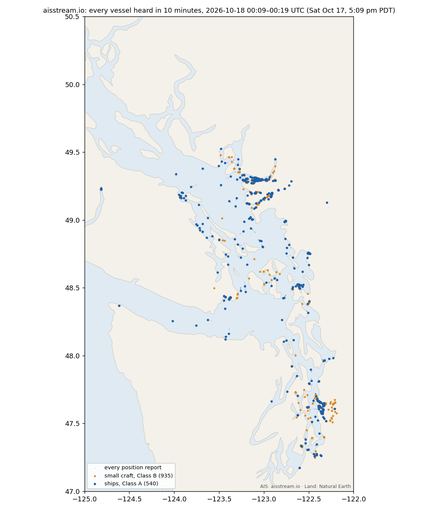

# aisstream.io: reference for a live AIS layer

Studied 2026-10-17. Sources:
- the developer docs <https://aisstream.io/documentation> (connection, subscription, limits, FAQ, schema explorer), as served on 2026-10-17;
- the home page <https://aisstream.io/> and privacy policy <https://aisstream.io/privacypolicy>;
- the published OpenAPI schema <https://github.com/aisstream/ais-message-models/blob/master/type-definition.yaml> (MIT, last commit 2023-06-28);
- the public issue tracker <https://github.com/aisstream/issues/issues>;
- two live samples over Haro Strait taken from localhost with Josh's key (see [Live sample](#live-sample-haro-strait-2026-10-17)).

Items marked **MEASURED** come from the samples. Items marked **UNVERIFIED** were not confirmed.

## What it is
A free WebSocket feed of decoded AIS messages from "our global network of Automatic
Identification System (AIS) stations" ([home page](https://aisstream.io/)). Sign-in is
through GitHub. API keys are created in Account ([home page](https://aisstream.io/)).
The site doesn't say who runs the receivers, how many there are, or where they are.
Issue [#301](https://github.com/aisstream/issues/issues/301), which asks how to add a
feeder, has no answer.

## Connection and subscription

| Item | Fact | Source |
|---|---|---|
| Endpoint | `wss://stream.aisstream.io/v0/stream` | [docs](https://aisstream.io/documentation) |
| Compression | Use `permessage-deflate`. `SubscriptionConfirmation.Message.CompressionEnabled` says whether it was negotiated. | [docs](https://aisstream.io/documentation) |
| Auth | `APIKey` goes in the subscription JSON. Keep it server-side. **Direct browser connections are not permitted**: "proxy only the information your clients need from your own server." | [docs](https://aisstream.io/documentation) |
| First message | You must send one complete JSON subscription **within 3 seconds** of opening, or the connection closes. | [docs](https://aisstream.io/documentation) |
| Updates | Resending a subscription **replaces** the previous one (it doesn't merge). At most 1 update per second per connection; going faster closes the connection. Each accepted subscription returns a `SubscriptionConfirmation`. An invalid one returns nothing. | [docs](https://aisstream.io/documentation) |
| Framing | The server sends **binary** WebSocket frames whose payload is UTF-8 JSON. The client may send text or binary frames, but not fragmented ones. | [docs](https://aisstream.io/documentation) |
| Reconnects | "Reconnect with exponential backoff and jitter, then send a complete replacement subscription within three seconds." | [docs](https://aisstream.io/documentation) |

### Subscription message
```json
{
  "APIKey": "<server-side key>",
  "BoundingBoxes": [[[48.4, -123.4], [48.7, -123.0]]],
  "FiltersShipMMSI": ["368207620"],
  "FilterMessageTypes": ["PositionReport"]
}
```
| Field | Required | Meaning | Source |
|---|---|---|---|
| `APIKey` | yes | account key | [docs](https://aisstream.io/documentation) |
| `BoundingBoxes` | yes | array of boxes. Each box is two `[lat, lon]` corners (latitude first). The schema type is `number<double>[][][]`. | [docs](https://aisstream.io/documentation), [schema](https://github.com/aisstream/ais-message-models/blob/master/type-definition.yaml) |
| `FiltersShipMMSI` | no | up to **200** MMSIs, each a nine-character **string** | [docs](https://aisstream.io/documentation) |
| `FilterMessageTypes` | no | any of the 25 type names below | [docs](https://aisstream.io/documentation) |

There's no time or history parameter. The stream is live only, and "events are not durably replayed" ([docs FAQ](https://aisstream.io/documentation)).

## Limits

| Constraint | Limit | Source |
|---|---|---|
| Subscribed connections per account | **3** (a 4th is rejected; existing connections keep priority) | [docs](https://aisstream.io/documentation), owner reply on [#292](https://github.com/aisstream/issues/issues/292) |
| Open connections per originating IP | **3**, enforced before auth | [docs](https://aisstream.io/documentation) |
| Initial subscription | within 3 s | [docs](https://aisstream.io/documentation) |
| Subscription updates | 1 per second per connection | [docs](https://aisstream.io/documentation) |
| MMSI filter | 200 per subscription | [docs](https://aisstream.io/documentation) |
| Slow readers | "If you do not consume messages quickly enough and sufficient buffered messages accumulate, the service drops messages." | [docs](https://aisstream.io/documentation) |
| Uncompressed connections | "Beginning in September 2026, uncompressed connections will be subject to per-user bandwidth limits." | [docs](https://aisstream.io/documentation) |
| Message quota or price | None published. The home page says "in real-time and for free". | [home page](https://aisstream.io/) |
| SLA | "No SLA or uptime guarantee, and events are not durably replayed." | [docs FAQ](https://aisstream.io/documentation) |

One user reports measuring **2** concurrent connections, with the 3rd refused by HTTP 429 ([#300](https://github.com/aisstream/issues/issues/300), open, no answer). **UNVERIFIED**: we haven't tested more than one connection.

### Reliability record (issue tracker)
- **August 2026 outage**: the feed was down about a week. Issue [#273](https://github.com/aisstream/issues/issues/273), opened 2026-08-11, says "It's been a week now since it stopped working". The owner's statement of 2026-08-22/23 (posted on [#279](https://github.com/aisstream/issues/issues/279), [#273](https://github.com/aisstream/issues/issues/273) and others) blames "a significant and unprecedented increase in load" and "a bug in circuit-breaker logic", and says "much of our small team had limited internet access".
- On 2026-09-14 the owner wrote, "We are very close to bandwidth capacity at the moment which may explain some of the recent increase in disconnects" ([#291](https://github.com/aisstream/issues/issues/291#issuecomment-5658544582)).

## Terms, license, attribution
- **No written terms of service or data license is published.** `https://aisstream.io/terms` returns 404. The footer links only to Documentation, Account, Privacy and Support (GitHub issues) ([home page](https://aisstream.io/)).
- The [privacy policy](https://aisstream.io/privacypolicy) covers only the account and request data aisstream collects about users (IP address, browser, GitHub identity). It says nothing about use of the AIS data.
- The **MIT license** in `ais-message-models` covers the schema and code, not the data ([README](https://github.com/aisstream/ais-message-models/blob/master/README.md)).
- **No attribution requirement is published.**
- Many users have asked for written permission (public display, caching, commercial use, attribution wording): [#290](https://github.com/aisstream/issues/issues/290), [#295](https://github.com/aisstream/issues/issues/295), [#298](https://github.com/aisstream/issues/issues/298), [#308](https://github.com/aisstream/issues/issues/308) and about 15 more (#283 to #314). As of 2026-10-17, **none has an owner reply**. #283 was closed without one. The owner's last comment anywhere in the tracker is dated 2026-09-14.
- AIS radio broadcasts are public by design, but aisstream itself states no position on reuse.

## Message envelope
```json
{
  "MessageType": "PositionReport",
  "MetaData": { "MMSI": 303561000, "MMSI_String": 303561000, "ShipName": "MADISON HUNTER      ",
                "latitude": 48.6111, "longitude": -123.16588,
                "time_utc": "2026-10-17 23:55:51.313911604 +0000 UTC" },
  "Message": { "PositionReport": { "...": "typed AIS fields" } }
}
```
- `MessageType` names the key under `Message` ([docs](https://aisstream.io/documentation)).
- `MetaData` is "Normalized context added by AIS Stream". The schema types it as a bare `object` with no fields ([schema](https://github.com/aisstream/ais-message-models/blob/master/type-definition.yaml)). **MEASURED**: every non-confirmation message carried exactly `MMSI`, `MMSI_String`, `ShipName`, `latitude`, `longitude` and `time_utc`, in that casing. `MMSI_String` came back as a **number**, not a string. `ShipName` is padded with trailing spaces to 20 characters on Class A messages. `time_utc` is a Go-style string with nanoseconds (`YYYY-MM-DD hh:mm:ss.nnnnnnnnn +0000 UTC`). It's the time aisstream stamped the message. The schema doesn't say whether that's the receiver's time or the server's.
- The `SubscriptionConfirmation` envelope has no `MetaData` ([docs](https://aisstream.io/documentation)).
- Numbers are emitted "without unnecessary trailing zeroes" ([docs FAQ](https://aisstream.io/documentation)).

## Message types and every field
The docs list 25 message types ([docs](https://aisstream.io/documentation)). The site's schema explorer
and the 2023 YAML have identical field lists. The site adds `SubscriptionConfirmation`
(`CompressionEnabled`), and the YAML adds `Error {error}`. Every AIS type starts with
`MessageID, RepeatIndicator, UserID (MMSI), Valid`, listed once here as **common**.
`Spare*` fields are omitted below.

| Type (AIS msg #) | Fields after common | Use for EarthAtlas |
|---|---|---|
| **PositionReport** (1/2/3, Class A) | NavigationalStatus, RateOfTurn, Sog (kn), PositionAccuracy, Longitude, Latitude, Cog (°), TrueHeading (°), Timestamp (UTC second, 60 = n/a), SpecialManoeuvreIndicator, Raim, CommunicationState | **core**: ships' live positions |
| **StandardClassBPositionReport** (18) | Sog, PositionAccuracy, Longitude, Latitude, Cog, TrueHeading, Timestamp, ClassBUnit, ClassBDisplay, ClassBDsc, ClassBBand, ClassBMsg22, AssignedMode, Raim, CommunicationStateIsItdma, CommunicationState | **core**: small craft |
| **ExtendedClassBPositionReport** (19) | Sog, PositionAccuracy, Longitude, Latitude, Cog, TrueHeading, Timestamp, Name, Type, Dimension{A,B,C,D}, FixType, Raim, Dte, AssignedMode | core: Class B with identity |
| **ShipStaticData** (5) | AisVersion, ImoNumber, CallSign, Name, Type (ship & cargo code), Dimension{A,B,C,D} (m from antenna to bow/stern/port/starboard), FixType, Eta{Month,Day,Hour,Minute}, MaximumStaticDraught (m), Destination, Dte | **identity + voyage**: name, type, size, draft, destination, ETA |
| **StaticDataReport** (24, Class B) | Reserved, PartNumber (false = part A), ReportA{Valid, Name}, ReportB{Valid, ShipType, VendorIDName, VenderIDModel, VenderIDSerial, CallSign, Dimension{A,B,C,D}, FixType} | identity for small craft (A and B arrive as separate messages) |
| LongRangeAisBroadcastMessage (27) | PositionAccuracy, Raim, NavigationalStatus, Longitude, Latitude, Sog, Cog, PositionLatency, (no Timestamp) | low-res satellite-range positions |
| StandardSearchAndRescueAircraftReport (9) | Altitude, Sog, PositionAccuracy, Longitude, Latitude, Cog, Timestamp, AltFromBaro, Dte, AssignedMode, Raim, CommunicationStateIsItdma, CommunicationState | SAR aircraft |
| AidsToNavigationReport (21) | Type, Name, PositionAccuracy, Longitude, Latitude, Dimension, Fixtype, Timestamp, OffPosition, AtoN, Raim, VirtualAtoN, AssignedMode, NameExtension | buoys and lights (incl. virtual) |
| BaseStationReport (4) | UtcYear…UtcSecond, PositionAccuracy, Longitude, Latitude, FixType, LongRangeEnable, Raim, CommunicationState | shore station locations |
| SafetyBroadcastMessage (14) | Text | broadcast safety text |
| AddressedSafetyMessage (12) | Sequenceinteger, DestinationID, Retransmission, Text | addressed safety text |
| BinaryBroadcastMessage (8) | ApplicationID{…}, BinaryData | e.g. met/hydro, area notices (undecoded) |
| AddressedBinaryMessage (6) | Sequenceinteger, DestinationID, Retransmission, ApplicationID, BinaryData | undecoded |
| SingleSlotBinaryMessage (25) / MultiSlotBinaryMessage (26) | DestinationIDValid, ApplicationIDValid, DestinationID, ApplicationID, Payload (+ CommunicationState on 26) | undecoded |
| GnssBroadcastBinaryMessage (17) | Longitude, Latitude, Data | DGNSS corrections |
| BinaryAcknowledge (7/13) | Destinations{…} | link control |
| Interrogation (15) | Station1Msg1, Station1Msg2, Station2 | link control |
| AssignedModeCommand (16) | Commands{…} | link control |
| DataLinkManagementMessage (20) (+ `DataLinkManagementMessageData`) | Data{…} | link control |
| ChannelManagement (22) | ChannelA, ChannelB, TxRxMode, LowPower, Area{…}, Unicast{…}, IsAddressed, BwA, BwB, TransitionalZoneSize | link control |
| GroupAssignmentCommand (23) | Longitude1/2, Latitude1/2, StationType, ShipType, TxRxMode, ReportingInterval, QuietTime | link control |
| CoordinatedUTCInquiry (10) | DestinationID | link control |
| UnknownMessage | Error | undecodable |

The schema describes fields only as "AIS X field" and doesn't define units or code tables.
These are the standard ITU-R M.1371 meanings (the same NavigationalStatus and ship-type
codes MarineCadastre uses; see [MARINECADASTRE_AIS.md](MARINECADASTRE_AIS.md)).

## Live sample: Haro Strait, 2026-10-17
**MEASURED.** I ran this from localhost with one connection and one box,
`[[48.4, -123.4], [48.7, -123.0]]` (Haro Strait from Lime Kiln to Victoria and Oak Bay),
with no type or MMSI filter. The first run lasted 60 s, starting 23:55:48 UTC. The second
lasted 300 s, starting 23:57:26 UTC (a Saturday evening, local time 16:57 PDT). Both runs
were free. The 5-minute run used about 30 KB after decompression, so this box costs
roughly 9 MB a day of inbound JSON. Raw JSONL was kept in the session scratchpad only.

### What arrived (5-minute run)
| | Count |
|---|---|
| Messages | 49 (plus 1 `SubscriptionConfirmation` about 0.9 s after connecting, `CompressionEnabled: true`) |
| Types | PositionReport 22 · StandardClassBPositionReport 18 · StaticDataReport 5 · ShipStaticData 4. No other types appeared. |
| Distinct MMSIs | 34. 29 had a position, and 6 of those were moving (≥ 1 kn). |
| First AIS message | about 5 s after connecting |
| Frames | all binary, as documented. The connection closed with code 1006 when the script ended it. |

The 60-second run produced 9 messages from 9 vessels, with no vessel heard twice.

### How live it is
| Measure | Result |
|---|---|
| **Delivery delay** (MetaData `time_utc` to our receipt) | median **2.2 s**, range 1.6–11.6 s |
| **Fix age at stamp** (AIS `Timestamp` second-of-minute vs `time_utc`) | median **1.2 s**, range −0.5 to 7.8 s (3 of 40 reported 60 = n/a) |
| **Position age when it reaches us** | about **3–10 s** |
| **Per-vessel update rate** | **At most one message per vessel per minute.** Repeat gaps were exactly 60.0 s, apart from a single 9 s pair, and some minutes were skipped (gaps of 120 s and 180 s). TSUKUBA MARU (12 kn) arrived at 23:57:53.375, 23:58:53.373 and 00:01:53.379, the same sub-second each time. The 23:59 and 00:00 reports never arrived. MY LADY JANE (fishing, 9.7 kn) arrived at :07.30 / :07.32 / :07.31. By the AIS standard, a Class A ship at that speed transmits about every 6–10 s, so **aisstream (or its upstream) delivers about 1 report per vessel per minute** in this box. It does not pass on every transmission. (Inferred from timing. aisstream doesn't document a downsample.) The Salish Sea-wide sample below confirms about 1/min as the typical rate for moving ships, with a few faster vessels that are probably heard by two receivers. |
| Movement per update | TSUKUBA MARU moved about 0.37 km per 60 s report at 12 kn, which matches its speed |
| Position resolution | `Message.*.Latitude/Longitude` are full doubles (up to 15 decimals). `MetaData.latitude/longitude` are rounded to 5 decimals (about 1 m). They agree within 0.000005°. SOG and COG are given to 0.1. |

### Field fill
| Field | Fill in sample |
|---|---|
| MetaData `ShipName` | 38 of 40 position messages. aisstream fills it **even on Class B msg 18**, which carries no name itself, so it must join names from earlier static messages. 2 Canadian Class B MMSIs were blank. |
| NavigationalStatus (Class A only) | 22 of 22 present: 0 under way ×13, 7 fishing ×5, 5 moored ×4. MADISON HUNTER reported 0 "under way" while at 0 kn, a common AIS mis-set. Class B has no nav status field. |
| TrueHeading | Class A 20/22 valid. Class B 4/18 valid (511 = n/a). |
| ShipStaticData (Class A identity + voyage) | 4 of 4 had Name, CallSign, Type (60 passenger, 37 pleasure, 36 sailing, 70 cargo), Dimension and Destination ("CAVIC", "VICTORIA BC", "GULF ISLANDS", "CA VAN > CA VIC"). IMO was present 2/4. ETA was set 2/4 (`Day 0 Hour 24 Minute 60` = n/a). Draught was set 3/4. |
| StaticDataReport (Class B identity) | 5 of 5 were **part A (name only)**. **No part B arrived**, so Class B ship type, call sign and size were 0 for all small craft in this sample. Static messages repeat every 6 min by the AIS standard, so a 5-minute window can miss them. |
| Bad identifiers | One MMSI was `987654321` ("CCG VIEW"), which is not a valid ship MMSI. A layer must tolerate junk IDs. |

### Canadian waters and small craft
- **Canadian waters: yes, heavily.** 29 of 49 messages came from MID 316 (Canada), and
  34 of 49 positions lay west of 123.25 °W (Victoria Harbour, Oak Bay, the Canadian side of
  Haro Strait). Vessels included BC Ferries-type passenger ships, CCG and RCM-SAR boats,
  Pacific pilots, and the research vessels FALKOR and RV JOHN STRICKLAND.
  MarineCadastre has **none** of this ([MARINECADASTRE_AIS.md](MARINECADASTRE_AIS.md)).
- **Small craft: yes.** There were 18 Class B messages from 17 vessels: yachts, sailboats,
  RCM-SAR 33 BRAVO, and a "DEFENDER CTOW OAKBAY" Class B unit. Most were stationary at marinas.
  Boats that carry no AIS never appear, from any AIS source.
- **Not checked**: how complete this is against the real traffic. We have no ground truth
  for that hour, and aisstream doesn't publish its receiver list. **UNVERIFIED.**

## Salish Sea coverage (10-minute sample)
**MEASURED.** One connection from localhost over the box `[[47.0, -125.0], [50.5, -122.0]]`
(Puget Sound to Desolation Sound, outer coast to the Cascades foothills), with no filters.
It ran 600 s, from 2026-10-18 00:09:10 to 00:19:09 UTC (Saturday, Oct 17, 5:09–5:19 pm
PDT). It used 4,565 messages and 2.7 MB after decompression (about 400 MB a day at this
rate). Raw JSONL and the analysis scripts (`salish.py`, `plot.py`) are kept in the gitignored
`scripts/shiptraffic/cache/aisstream/`. This is **one 10-minute sample on a weekend
evening**. Traffic and coverage at other hours are not measured.

**Repeat check:** a second 10-minute connection over the same box (00:05:51–00:15:50 UTC, overlapping the first) gave the same picture. It had 1,489 vessels with a position (987 US, 417 Canadian), the same delivery delay (median 2.2 s), and moving ships at a median gap of 61 s (p90 188 s), with Class B at 180 s.


(Land: Natural Earth.)

### What arrived
| | Count |
|---|---|
| Messages | 4,565: PositionReport 1,904 · StandardClassBPositionReport 1,605 · StaticDataReport 780 · ShipStaticData 276. No other message types appeared in 10 minutes, so there were no aids to navigation, base stations, safety texts or SAR aircraft. |
| Distinct MMSIs | **1,673**, of which **1,475 had a position**. By class: Class A 493, Class B 1,103, and 77 that sent both. |
| Flag (MID of vessels with a position) | US (338/366–369) 979 · Canada (316) 409 · other 87 |
| Moving (≥ 1 kn, last report) | 157 of 1,475. Most were moored or at anchor (Saturday evening). |

### Vessels by area (last position; approximate rectangles in `salish.py`)
| Area | Vessels | Moving ≥ 1 kn | Class A median gap |
|---|---|---|---|
| Puget Sound (S of 48.15 °N, E of 123.0 °W) | 644 | 59 | 60 s |
| Vancouver / Burrard Inlet / Fraser River | 356 | 41 | 71 s |
| Bellingham / Blaine / Skagit | 190 | 5 | 141 s (mostly moored) |
| Haro Strait / San Juans / Rosario | 157 | 19 | 60 s |
| Strait of Georgia + Gulf Islands | 76 | 24 | 71 s |
| Strait of Juan de Fuca | 40 | 8 | 110 s |
| Outer coast / western Juan de Fuca (W of 124.3 °W) | 10 | 0 | 120 s |

**Thin coverage (observed on the map):**
- **The main Juan de Fuca shipping lanes** carry only a handful of reports.
- **West of about 124.3 °W** (Cape Flattery, Swiftsure Bank, the outer coast) is nearly empty.
- **The Strait of Georgia north of Nanaimo** (Texada, Comox, Powell River) has no vessels at all.
- **Hood Canal and the southern Puget Sound inlets** are sparse.
- A single sample can't separate "no ships" from "no receiver in range". Juan de Fuca is
  normally a continuous shipping lane, so the near-empty lane points to a receiver gap.
  **UNVERIFIED**: no ground truth for this hour, and aisstream doesn't publish its
  receiver locations.

### How live it is (whole Salish Sea)
| Measure | Result |
|---|---|
| Delivery delay (`time_utc` to our receipt) | p10 1.9 s · median **2.2 s** · p90 2.4 s · max 13.6 s |
| Fix age at stamp (AIS `Timestamp` vs `time_utc`) | p10 0.0 s · median **0.9 s** · p90 2.1 s · max 29.8 s |
| **Position age on arrival** | typically **about 3–5 s** |
| **Moving ships (Class A, median ≥ 3 kn; 95 vessels)** | gaps after merging copies under 2 s apart: p10 20 s · **median 60 s** · p90 180 s · max 468 s. 55% of gaps were ≤ 65 s. Each ship sent a median of **5 reports in 10 minutes** (min 1, max 11), about **0.5 distinct reports a minute**. By the AIS standard a moving Class A ship transmits every 2–10 s, so roughly 60–300 transmissions in that time. |
| Moving ships by area (median / p90 gap) | Puget Sound 60 / 180 s · Haro–San Juans 60 / 170 s · Vancouver 60 / 180 s · Georgia Strait 67 / 171 s · Juan de Fuca 62 / 250 s |
| All Class A (incl. moored) | median gap 69 s, p90 209 s |
| Class B (small craft) | p10 116 s · median **181 s** · p90 361 s. That matches the AIS standard's 3-minute interval for slow or stationary Class B. |
| Exact-60-s pattern | 21–31% of Class A gaps per area were exact multiples of 60 s (±0.1 s). That's the "one report a minute at the same sub-second" pattern first seen in Haro Strait. |
| Near-duplicates | 83 of 2,034 gaps were under 2 s. Example: DUTCHMAN in Bellingham arrived twice 0.2 s apart with the same position, one copy with `Timestamp` 28 and one with 60. That looks like two receivers each forwarding one report a minute (inferred). |

**Conclusion (inferred from timing):** aisstream delivers about **one position per vessel
per minute per receiver**, not every transmission. A moving ship typically shows up every
60 s and sometimes only every 2–3 minutes. A ship heard by two receivers can show up more
often. Positions are a few seconds old when they arrive. For a map, that means points that
are current to the minute and jump about 300–600 m per update at 10–20 kn.

### Identity and voyage fill (10 minutes)
| Field | Fill |
|---|---|
| ShipStaticData (msg 5) received | for 197 of 540 Class A vessels with a position (the AIS standard repeats it every 6 min, so a 10-min window should catch nearly every ship; only 37% arrived, consistent with static messages also being thinned) |
| … Name / Type / Dimensions | 197/197 · 187/197 · 184/197 |
| … Destination / Draught / IMO / ETA | 151/197 · 149/197 · 122/197 · 93/197 |
| Ship types seen (msg 5) | passenger 60 ×31, tug 52 ×31, fishing 30 ×27, cargo 70 ×23, towing 31 ×15, pleasure 37 ×13, unset 0 ×10, tanker 80 ×5, cargo 79 ×5, … |
| StaticDataReport (msg 24, Class B) | part A (name) from 473 of 1,011 Class B vessels; **part B (type, size) from only 46**, mostly pleasure craft (37 ×39) |
| MetaData `ShipName` blank | 50 of 1,475 vessels with a position. aisstream fills names on position messages from static messages it has already seen. |
| NavigationalStatus (Class A position messages) | under way 0 ×1,193 · moored 5 ×242 · undefined 15 ×242 · sailing 8 ×74 · fishing 7 ×51 · at anchor 1 ×50 · other 52 |

## aisstream vs NOAA MarineCadastre: same box, same metrics
**MEASURED** with `scripts/shiptraffic/cache/aisstream/compare_noaa.py`. It runs over the box
both sources cover (47.0–49.6 °N, 125.0–122.05 °W, where the aisstream sample overlaps
/ships' `salish-v6` NOAA cache). NOAA comes from the local daily Parquet cache
(`scripts/ships/bake-ais/cache/points/salish-v6/`, MarineCadastre daily points, CC0). NOAA
hasn't published the same day yet (its newest is 2026-06-30), so the comparison uses
**matching Saturday evenings** at the same clock time, 5:09–5:19 pm PDT. Traffic differs from
year to year, so these are like-for-like windows, not the same ships.

| 10 minutes, Saturday 5:09 pm PDT | aisstream 2026-10-17 | aisstream (repeat run) | NOAA 2025-10-18 | NOAA 2026-06-27 |
|---|---|---|---|---|
| Positions | **3,509** | 3,471 | **6,636** | 8,537 |
| Vessels | **1,475** | 1,485 | **2,146** | 2,486 |
| … US / Canada / other | 979 / 409 / 87 | 987 / 413 / 85 | 1,498 / 519 / 129 | 1,713 / 641 / 132 |
| Positions per vessel per minute | 0.24 | 0.23 | 0.31 | 0.34 |
| Moving ships (median ≥ 3 kn) | 148 | 153 | 114 | 273 |
| … positions each in 10 min (median) | **4** | 4 | **8** | 7 |
| … gap between positions, median / p90 | **65 s / 212 s** | 69 s / 221 s | **70 s / 92 s** | 70 s / 118 s |
| Strait of Juan de Fuca: vessels / positions | **43 / 98** | 41 / 83 | **107 / 461** | 129 / 514 |
| North of 49 °N: vessels / positions | 414 / 1,096 | 411 / 1,075 | 376 / 1,417 | 470 / 1,856 |

The NOAA cache includes Canadian vessels north of 49 °N, about 300–380 per 10 minutes. US
receivers hear them, and the `salish-v6` note in `scripts/ships/bake-ais/region.py` says NOAA
coverage is strong up to about 49.5 °N. So "Canadian waters are not covered" in
[MARINECADASTRE_AIS.md](MARINECADASTRE_AIS.md) holds only beyond US receiver range.

**What it shows (October against October):**
- **About half the volume.** aisstream delivered 53% of NOAA's positions and 69% of its
  vessels in the same window.
- **The same nominal rate, but more holes.** Both sources cap a vessel at about one position a
  minute. NOAA's moving ships report steadily (median 70 s, p90 92 s, 8 positions in 10 min).
  aisstream skips minutes (p90 212 s, 4 positions in 10 min).
- **Juan de Fuca is the big gap.** aisstream had about 40% of NOAA's vessels there and about
  20% of its positions.
- **North of 49 °N, aisstream holds up.** It had as many vessels as NOAA, with about 75% of
  the positions.

**Daily volume:**
- **NOAA, common box, one UTC day:** 818,173 positions and 2,785 vessels (2025-10-19);
  1,175,948 positions and 3,664 vessels (2026-06-28). A NOAA day of the slightly larger
  `salish-v6` box is a 7–12 MB Parquet file.
- **aisstream:** about 350 positions a minute at the sampled hour, so very roughly 0.5 M a
  day if that rate held (it won't overnight; not measured). That's 400 MB a day of raw JSON
  on the wire. Stored in the same Parquet layout, it would be about NOAA's size or smaller.

### Using aisstream to extend NOAA-style data past NOAA's last month
- **It can only cover days from when recording starts.** aisstream has no history or replay,
  so 2026-07-01 up to the start of recording can't be filled from it. GFW's hourly tracks
  stay the only source for that gap.
- **Recording has to be continuous** on one of the 3 allowed connections, run outside
  Vercel. Disconnects and aisstream outages leave holes that can't be filled later.
- **It fits NOAA's schema.** Every NOAA daily-points column has an aisstream source except `cargo`
  (NOAA's separate cargo code; aisstream has only the ship-type code). The USCG identity
  corrections NOAA applies are also missing. The mapping is: `mmsi` ← UserID, `base_date_time` ←
  `time_utc`, lat/lon, `sog`/`cog`/`heading`, `status` ← NavigationalStatus, `vessel_name`,
  `imo`, `call_sign`, `vessel_type`, `draft` ← msg 5/24, `length`/`width` ← Dimension A+B /
  C+D, `transceiver` ← A or B from the message type. The existing NOAA bakes
  (`scripts/ships/bake-us/build_us_points.py`, `scripts/ships/bake-ais/build_tracks.py`)
  could then read it unchanged. Their 30-minute track-break rule already tolerates
  aisstream's 2–3 minute holes.
- **Expect about half NOAA's density**, and much less in Juan de Fuca and on the outer
  coast. Lines will look the same where traffic is heavy and thinner where coverage is weak.
- **The license is still open.** Storing and republishing derived tracks is exactly what the
  unanswered permission requests on aisstream's tracker ask about.

## Compared with what /ships and /shiptraffic use today
| | aisstream.io | NOAA MarineCadastre | GFW tracks |
|---|---|---|---|
| Age of newest data | **~3–10 s** | ~3+ months (daily CSVs end 2026-06-30) | ~96 h (presence) |
| Time resolution per vessel | moving ships: median 1 report/60 s, p90 180 s; small craft 1 per 2–6 min | ~1 position/min (NOAA downsample) | 1 position/hour |
| History | **none** (live only, no replay) | 2015 → | 2012 → |
| Canadian Salish Sea | **yes** | no | yes (hourly) |
| Small craft (Class B) | yes | yes (US only) | partial |
| Identity quality | raw self-reported (junk MMSIs, blanks) | USCG-corrected (AVID) | GFW-matched identity |
| License | **none published** | CC0 | GFW terms (non-commercial) |
| Reliability | no SLA; ~1-week outage in Aug 2026; near bandwidth capacity (Sept 2026) | static files | API |

## What a live layer would need (facts for planning, no design yet)
1. **A server-side relay.** Browsers may not connect directly
   ([docs](https://aisstream.io/documentation)). Vercel functions can't hold a socket
   indefinitely, so the relay is either an always-on worker outside Vercel, or a
   per-minute Vercel cron that connects for under 60 s and writes a snapshot. Both use 1 of
   the 3 account connections. **Costs not yet estimated; to be decided with Josh.**
2. **A latest-position store** keyed by MMSI, with `time_utc`, plus static data joined from
   msgs 5/24. Because static messages repeat only every 6 minutes, identity fills in over the
   first minutes after a cold start. The client polls it (e.g. every 30–60 s, matching the
   1/min cadence).
3. **Our own history if we want tails or tracks**, since aisstream doesn't replay.
4. **Bounding boxes sized to the subsite** (the Salish Sea), with compression on, since
   uncompressed connections face per-user bandwidth limits from September 2026.
5. **Inline provenance on every live point:** "AIS via aisstream.io" with the report time.
   Because no license or attribution terms are published, the right to display it publicly
   is unconfirmed. That's Josh's call.
6. **Reconnect with backoff, a staleness indicator** (outages are silent: the socket stays
   open with no data, per [#279](https://github.com/aisstream/issues/issues/279)), and
   tolerance for invalid MMSIs and blank names.
